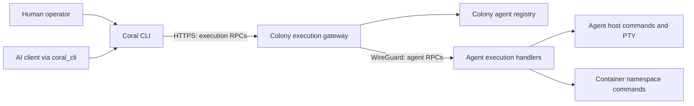

# RFD 115 - Colony Execution Gateway for Shell and Exec

**Status:** 👀 Under Review

## Summary

Route named-target `coral shell` and `coral exec` operations through an
authenticated Colony API. The CLI reaches the Colony over HTTPS; the Colony
resolves the target and calls the agent over its existing WireGuard connection.
Operators and AI clients can execute commands and open interactive shells
without joining the mesh or obtaining direct access to agent listeners.

Explicit `--agent-addr` connections and untargeted local shells remain available
for local troubleshooting. Named targets use the gateway regardless of whether
the configured Colony endpoint uses HTTP or HTTPS, and never silently fall back
to direct agent access.

## Problem

### Registry lookup is currently followed by a direct agent connection

`internal/cli/agent/resolve.go` calls the Colony's `ListAgents`, resolves the
requested agent or service to its mesh IP, and returns `{meshIP}:9001`.
`internal/cli/agent/shell.go` and `internal/cli/agent/exec.go` then construct
agent clients and call `Shell`, `ShellExec`, or `ContainerExec` directly.

This works when the CLI host can reach the agent, including suitable local
Colony deployments. A workstation configured with only the remote Colony's
HTTPS endpoint can resolve a target but cannot reach that target's mesh IP.
Target discovery succeeding therefore does not establish execution connectivity.

### Earlier Colony-mediated execution was tied to retired MCP tools

RFD 017 originally illustrated execution through a Colony RPC. RFDs 045 and
056 described Colony MCP handlers forwarding one-off shell and container
commands to agents. RFD 100 removed the per-operation Colony MCP handlers and
made the local CLI the execution surface. That surface now needs normal Colony
execution RPCs so both human and AI callers retain remote access.

RFD 038 proposes CLI mesh membership as another approach, but remains a draft
and requires peer configuration orchestration. RFD 096 already solves the
equivalent reachability problem for agent DuckDB access through a scoped
Colony proxy. Neither defines the current CLI's shell/exec gateway.

### The overview conflates collection and execution

`docs/architecture/system-overview.md` shows a direct CLI-to-"Agent collectors"
edge labeled "Debugging and execution" under "A telemetry operation". Shell
execution reaches agent RPC handlers, while uprobe debugging already goes
through Colony orchestration. The diagram neither explains the connectivity
requirement nor distinguishes these paths.

## Solution

Add a typed `ColonyExecutionService` with two unary RPCs and an interactive
bidirectional RPC. The Colony owns target resolution and admission; the agent
continues to own command execution and PTY resources.



This is an execution path, independent of telemetry polling. It does not
restore per-operation MCP tools: `coral_cli` continues to dispatch local CLI
commands, which use the same gateway as human invocations.

### Routing and compatibility

| CLI invocation                                 | Execution path                                        |
|------------------------------------------------|-------------------------------------------------------|
| `coral shell --agent AGENT`                    | Colony gateway to the selected agent                  |
| `coral shell --agent AGENT -- COMMAND ...`     | Colony gateway, one-off host command                  |
| `coral exec SERVICE COMMAND ...`               | Colony gateway, service resolved by Colony            |
| `coral exec SERVICE --agent AGENT COMMAND ...` | Colony gateway, explicit agent constrained to service |
| `coral shell` or `coral shell -- COMMAND ...`  | Existing local-agent discovery and direct connection  |
| Either command with `--agent-addr ADDRESS`     | Explicit direct connection using existing agent API   |

`--agent` and `--agent-addr` remain mutually exclusive. An explicit Colony
selection combined with `--agent-addr` is rejected rather than ignored. Direct
connections are outside the gateway's authentication and audit guarantees.

The CLI uses the existing Colony URL, CA configuration, and
`CORAL_API_TOKEN`. Endpoint scheme does not select a different execution
architecture: localhost HTTP and remote HTTPS named-target requests both use
the gateway. The existing local discovery behavior for an untargeted shell is
preserved; a positional service selector is not added to `coral shell`.

The protobuf addition is compatible with existing agents. Changing named-target
CLI routing and requiring an API token is a user-visible breaking change.
Against an older Colony, the CLI reports that the execution gateway requires a
Colony upgrade. It does not attempt the agent RPC after an `Unimplemented`,
authentication, permission, or transport failure. Operators who deliberately
need a direct connection can supply `--agent-addr`.

### Target resolution

Resolve the target in the Colony before sending any execution request:

- An agent-only target must match an enrolled registry entry.
- A service-only target must match exactly one eligible agent. Multiple matches
  return `FailedPrecondition` and require an explicit agent ID; do not select
  the first registry entry.
- When both fields are present, the selected agent must advertise that service.
- Empty targets, malformed selectors, unknown targets, and unavailable agents
  fail before execution. Legacy component-name fallback may be retained for
  service matching, with the same uniqueness requirement.

An eligible agent has a healthy registry status and a valid enrolled mesh
address. Explicitly selecting an unhealthy agent fails with `Unavailable`;
it does not authorize execution against a replacement. A known service with
no eligible agents also returns `Unavailable`, rather than `NotFound`.

Use the resolved registry entry's mesh address and supported agent RPC port.
The current agent client assumes port 9001; this RFD does not introduce agent
port discovery. Requests cannot supply an upstream hostname, URL, or port.
Pin the selected agent for the operation's lifetime. A registry change or
disconnect never redirects a running command to another replica.

Selecting an agent hosting a service does not fix container selection inside
that agent. `ContainerExec` retains the existing `nsenter` behavior and its
documented PID-selection and `--container` limitations.

### Authentication and authorization

All three procedures require a valid Colony API token and `PermissionAnalyze`
(or `PermissionAdmin`). This matches the existing permission model for the
former `coral_shell_exec` and `coral_container_exec` MCP tools. `status`,
`query`, and `debug` alone do not grant execution access. The permission is
Colony-wide; per-agent policies and approval workflows remain separate work.

Register the execution service on both Colony listeners behind a dedicated
authentication and permission gate. Load the existing token store for this
gate even when the optional public endpoint is disabled. Neither mesh
reachability nor `public_endpoint.auth.require: false` bypasses this gate.
The gate is a dedicated interceptor on the execution handler, independent of
the `requireAuth` decision in the HTTP middleware chain, which can be disabled
by configuration. When the HTTP chain also authenticates, both checks apply and
the interceptor remains authoritative. The existing `/RequestCertificate` suffix
exemption and the `/duckdb` and `/agent/` prefix exemptions must not match any
execution procedure; tests pin this. Startup must not expose an unguarded
execution handler if token-store loading fails. An empty store simply admits no
execution callers until a token exists.

Map every new procedure explicitly in the HTTP RBAC table and also enforce the
execution permission in the shared execution gate. Unknown procedures under
this service must not inherit the current general `PermissionStatus` fallback.
The shared gate ensures internal and public registrations have the same policy.

Use the typed Connect service path, never `/agent/{id}/...`: the current public
server exempts the `/agent/` DuckDB proxy prefix from authentication. RFD 096's
read-only proxy exception must not extend to execution.

The authenticated token ID (`auth.APIToken.TokenID`) is the caller identity at
the Colony; the gate stores it in the request context for handlers and limits.
Overwrite the
nested agent request's `user_id` with that identity before forwarding. Preserve
the CLI's `--user-id` value only as an explicitly unverified audit label; it
cannot impersonate a token or authorize an action. Do not forward the bearer
token or arbitrary client headers to the agent.

### One-off commands

`ShellExec` and `ContainerExec` wrap the existing agent requests and return the
existing response messages. Preserve command argument boundaries, working
directory, environment overrides, namespace options, stdout, stderr, duration,
session ID, and exit code. The Colony does not invoke a local shell or join the
argument array into a command string.

Keep the existing execution timeout defaults: 30 seconds by default, capped at
300 seconds. Propagate a shorter caller deadline and cancellation to the agent,
allowing response handling time when choosing downstream deadlines. Preserve
agent Connect error codes and typed details, including partial output attached
to a `ShellExec` deadline error. Preserve `ContainerExec`'s existing behavior,
where
`internal/agent/container_handler.go` returns a successful response with
`exit_code = -1` and the `error` field set for timeouts and non-exit failures,
and only returns a Connect error for empty commands or failed PID detection;
the gateway must not convert that response into a Connect error.

Never automatically retry an execution RPC, including after an upstream dial
or response error. A lost response can mean the command already ran. Classify
every failed execution with a machine-readable `ExecutionFailure` error detail
(defined under API Changes) that has three origins:

- `NOT_DISPATCHED`: the failure proves the agent never received the request,
  such as authentication, validation, target resolution, admission, or an
  upstream dial error before any bytes were written.
- `AGENT_REPORTED`: the agent returned a definitive response or Connect error,
  such as failed PID detection, executable-start failure, or the timeout
  response with partial output. The Colony forwards the original code, message,
  and typed details unchanged and only appends the classification detail.
- `OUTCOME_UNKNOWN`: the request may have reached the agent but no definitive
  agent result arrived, such as a reset, timeout, or EOF after the request was
  written. The Colony returns `Unavailable` (or the transport's code) with this
  detail and an `execution outcome unknown` message.

The Colony-to-CLI leg is equally uncertain, and the Colony cannot report a
lost connection to itself. The CLI therefore classifies independently: once it
has begun sending a request, any failure without a received `NOT_DISPATCHED` or
`AGENT_REPORTED` classification is outcome unknown. That covers a dropped
connection, reset, deadline, or EOF while awaiting the response; a stream that
ends without `ShellExit`; and an error response lacking `ExecutionFailure`,
such as one generated by an ingress. Only a dial or TLS failure before the
request is written, or an HTTP 401/403 from the Colony's authentication
middleware, is known not to have executed. For unknown outcomes the CLI exits
with a distinct status and message, never prints a successful command exit, and
never retries on another agent. This RFD adds neither exactly-once execution
nor a durable result store.

### Interactive shells

The CLI opens `ColonyExecutionService/Shell` using gRPC bidirectional streaming
over HTTP/2. HTTPS uses the same TLS trust configuration as unary Colony
requests; loopback/internal HTTP uses an explicit h2c transport. Attach the
bearer token to the stream-opening request. Existing unary-only authentication
interceptors are insufficient and must be extended for streaming calls.

The first frame contains a target and `ShellStart`. Authenticate, authorize,
validate, and resolve it before opening the downstream agent stream. Forward
one agent `ShellStart` with the authenticated identity, then relay stdin,
terminal resize, signals, output, and the final `ShellExit`. Any
`stdin`, `resize`, or `signal` frame before `start`, a second `start`, or a
`resize` with zero rows or columns is `InvalidArgument`. A downstream write that
makes no progress for 30 seconds ends the session with `DeadlineExceeded`. Later
frames cannot change target or start a second shell. Resize and signals travel
on the
same stream; this RFD adds no public session-control RPCs addressing arbitrary
session IDs.

Run input and output forwarding concurrently, preserve order within each
direction, and apply backpressure without accumulating unbounded message
queues. Forward output as it arrives. Ensure HTTP middleware preserves
flushing and HTTP/2 streaming. In particular, `statusResponseWriter` in
`internal/colony/httpapi/middleware_audit.go` wraps the response writer without
`http.Flusher` or `Unwrap()` support and would buffer or break streamed
output; it, and any rate-limit or RBAC wrappers, must delegate flushing. The
ordinary unary response path is not an adequate test of this behavior.

Use a 10-second first-frame deadline and a maximum interactive lifetime of one
hour, shortened by any caller deadline. Enforce the lifetime on the downstream
context as well. Limit gateway frames to 1 MiB and active interactive sessions
to 32 per Colony process, counted across both listeners, with at most 8 per
token ID; reject excess sessions with
`ResourceExhausted` before contacting an agent. These initial limits are
implementation constants, not new configuration fields.

Neither Colony HTTP server may set `ReadTimeout`, `WriteTimeout`, or
`IdleTimeout` values that would end a session before its lifetime; today both
set only `ReadHeaderTimeout`, which is compatible. The rate limiter charges one
admission per stream, not per frame.

Enable transport keepalive and broken-peer detection on both streaming legs.
Token validation and permission checks happen at admission; revoking a token
prevents new calls but does not promise immediate termination of an existing
stream. The session deadline still applies.

On client cancellation or transport loss, cancel the downstream stream and
release relay resources. On agent exit, forward its final exit frame before
closing and cancel the input pump so a blocked read cannot retain the session.
Treat request-side EOF as ending the interactive session, consistent with the
current agent behavior. All termination paths must join or otherwise release
blocked forwarding tasks and let the agent clean up its PTY and shell process.
Agent changes needed to satisfy cleanup tests are part of this RFD, limited to
process and PTY teardown on cancellation, EOF, and exit in
`internal/agent/shell_handler.go` and `internal/sys/shell/`; defects outside
that lifecycle are separate work. The agent RPC contract is unchanged.

A stream ending without `ShellExit` is an interrupted session, not exit code
zero. A Colony restart ends active shells; there is no reconnection, replay, or
session resumption. Network-partition cleanup depends on detecting the broken
transport or reaching the downstream deadline; instantaneous cleanup is not
guaranteed.

HTTP/2 streaming must work through every configured ingress hop. If an ingress
cannot carry the stream, report the transport error and the HTTP/2 requirement.
Do not fall back to direct mesh access or add a WebSocket transport in this RFD.

### Audit metadata and limits

Log admission and completion at the Colony with a generated operation ID,
authenticated token ID, unverified caller label when supplied, resolved agent,
service selector, RPC kind, duration, result/error code, and agent session ID
when returned. The agent's existing `user_id` logs then identify the token
rather than trusting a caller-supplied operating-system username.

Read identity from the authenticated handler context. The existing outer HTTP
audit middleware cannot be assumed to see a child request's context changes.
Use execution-handler logs to establish this association. Do not log bearer
tokens, environment values, stdin, stdout, or stderr. These are metadata logs,
not a durable terminal transcript or complete command-history audit.

The Colony now carries execution traffic and is a failure point for these
sessions. Interactive traffic is streamed with bounded queues; one-off output
retains the existing agent's buffered response behavior. This RFD does not
claim bounded command-output storage or support bulk data export through exec.

### Component Changes

1. **Protocol**: Add `proto/coral/colony/v1/execution.proto` and generate the
   Colony execution client and server bindings. Reuse agent payloads.
2. **Colony**: Add target resolution, agent forwarding, and interactive relay
   handlers under `internal/colony/`; wire authenticated registration in
   `internal/cli/colony/server.go` and `internal/colony/httpapi/server.go`.
3. **Authentication and transport helpers**: Share token-store initialization,
   enforce the execution permission on both listeners, and support TLS/h2c
   streaming clients with authentication in `internal/cli/helpers/`.
4. **CLI**: Replace named-target direct connections in `internal/cli/agent/`
   with execution-service calls. Retain the local/direct paths and existing
   terminal handling and command-output semantics.
5. **Agent lifecycle**: Verify cancellation, process exit, and PTY cleanup in
   `internal/agent/shell_handler.go` and `internal/sys/shell/`; correct
   lifecycle
   defects exposed by forwarding tests without changing container selection.

## API Changes

### New execution service

Add the following complete service contract in
`proto/coral/colony/v1/execution.proto`. Generated code follows repository
conventions. Imported request and response types remain defined by the agent
API; no agent protobuf changes are required.

```protobuf
syntax = "proto3";

package coral.colony.v1;

import "coral/agent/v1/agent.proto";

option go_package = "github.com/coral-mesh/coral/proto/colony/v1;colonypb";

service ColonyExecutionService {
    rpc ShellExec(ColonyShellExecRequest)
        returns (coral.agent.v1.ShellExecResponse);
    rpc ContainerExec(ColonyContainerExecRequest)
        returns (coral.agent.v1.ContainerExecResponse);
    rpc Shell(stream ColonyShellRequest)
        returns (stream coral.agent.v1.ShellResponse);
}

// At least one selector is required. Both constrain selection when present.
message ExecutionTarget {
    string agent_id = 1;
    string service_name = 2;
}

message ColonyShellExecRequest {
    ExecutionTarget target = 1;
    // user_id is an unverified label, replaced with the token ID downstream.
    coral.agent.v1.ShellExecRequest execution = 2;
}

message ColonyContainerExecRequest {
    ExecutionTarget target = 1;
    // user_id is an unverified label, replaced with the token ID downstream.
    coral.agent.v1.ContainerExecRequest execution = 2;
}

message ColonyShellStart {
    ExecutionTarget target = 1;
    // user_id is an unverified label, replaced with the token ID downstream.
    coral.agent.v1.ShellStart shell = 2;
}

message ColonyShellRequest {
    oneof payload {
        ColonyShellStart start = 1;
        bytes stdin = 2;
        coral.agent.v1.ShellResize resize = 3;
        coral.agent.v1.ShellSignal signal = 4;
    }
}

// ExecutionFailure is attached as a Connect error detail to every error the
// gateway returns, alongside any preserved agent details.
message ExecutionFailure {
    enum Origin {
        ORIGIN_UNSPECIFIED = 0;
        // The agent never received the request.
        ORIGIN_NOT_DISPATCHED = 1;
        // The agent returned a definitive error; original code and details kept.
        ORIGIN_AGENT_REPORTED = 2;
        // The request may have run, but no definitive result arrived.
        ORIGIN_OUTCOME_UNKNOWN = 3;
    }
    Origin origin = 1;
    // Colony-generated operation ID, matching the admission and completion logs.
    string operation_id = 2;
}
```

`ORIGIN_UNSPECIFIED` is never emitted; a client receiving it or no detail
treats the outcome as unknown once the request has been sent. The service
exposes only the three named procedures. It is not a generic
reverse proxy for arbitrary agent APIs. Request and start payloads must be
present; commands must be nonempty, and each streaming message must contain a
valid payload. An approval ID in an imported `ShellStart` is not evidence that
an approval workflow has run; this gateway does not implement RFD 043.

### Errors and permission mapping

| Condition                                                         | Result                                                                                      |
|-------------------------------------------------------------------|---------------------------------------------------------------------------------------------|
| Missing/invalid token                                             | `Unauthenticated`, or existing HTTP 401 rejection                                           |
| Token lacks `analyze`/`admin`                                     | `PermissionDenied`, or existing HTTP 403 rejection                                          |
| Empty target, missing payload, invalid stream sequence            | `InvalidArgument`                                                                           |
| Agent/service not registered                                      | `NotFound`                                                                                  |
| Service matches multiple eligible agents                          | `FailedPrecondition`; require an agent ID                                                   |
| Explicit agent does not host requested service                    | `FailedPrecondition`                                                                        |
| Selected agent unavailable                                        | `Unavailable`                                                                               |
| Interactive admission/frame limit exceeded                        | `ResourceExhausted`                                                                         |
| Agent-reported failure                                            | Preserve the agent's Connect code and typed details; add `ExecutionFailure(AGENT_REPORTED)` |
| Deadline, cancellation, or transport loss after possible dispatch | Preserve the applicable Connect code; add `ExecutionFailure(OUTCOME_UNKNOWN)`               |
| Failure before the agent receives the request                     | Applicable code plus `ExecutionFailure(NOT_DISPATCHED)`                                     |

Explicitly map `/coral.colony.v1.ColonyExecutionService/ShellExec`,
`/coral.colony.v1.ColonyExecutionService/ContainerExec`, and
`/coral.colony.v1.ColonyExecutionService/Shell` to `PermissionAnalyze`.
An application process returning a nonzero exit code remains a command result,
not a network error.

### CLI and configuration

```bash
# Existing Colony endpoint/CA configuration and API token apply.
# The workstation needs no route to agent mesh IPs.
coral shell --agent hostname-api-1 -- ps aux
coral shell --agent hostname-api-1
coral exec api --agent hostname-api-1 cat /app/config.yaml

# Explicit direct connection, for example to a local agent.
coral shell --agent-addr localhost:9001 -- ps aux
coral exec api --agent-addr localhost:9001 cat /app/config.yaml
```

Successful one-off commands retain their existing stdout, stderr, and process
exit status. Interactive shells retain terminal resize and signal handling and
return the remote shell's exit status. Missing gateway credentials fail before
execution with guidance to configure `CORAL_API_TOKEN`; unsupported Colonies
produce an upgrade message rather than a mesh-IP timeout.

No new configuration keys, tokens, MCP tools, database tables, or SDK APIs are
introduced. Existing API tokens with `analyze` or `admin` grant gateway access;
named-target users who previously relied on mesh reachability, including
localhost and local-Colony users who ran `coral shell --agent` or `coral exec`
without a token, must configure one. Sharing token-store loading across
listeners does not enable the public
endpoint automatically.

## Implementation Plan

### Phase 1: Protocol and authenticated admission

- [ ] Add `execution.proto`, generate bindings, and validate the protobuf API.
- [ ] Share existing token-store initialization with the execution gate even
  when the public endpoint is disabled.
- [ ] Register the guarded execution service on internal and public Colony
  listeners, including explicit procedure permissions and denial of unknown
  execution procedures. Verify the DuckDB auth exception cannot match it.
- [ ] Implement deterministic target resolution, payload validation, and
  authenticated identity substitution before dispatch. Pin that exemption
  prefixes and suffixes cannot match execution procedures.

### Phase 2: Unary forwarding and interactive relay

- [ ] Forward `ShellExec` and `ContainerExec` without retries, preserving
  response fields, upstream error details, deadlines, and cancellation, and
  attach `ExecutionFailure` to every returned error.
- [ ] Implement concurrent interactive forwarding with startup/lifetime/frame
  limits, admission limits, backpressure, and final-exit handling.
- [ ] Preserve HTTP/2 response streaming through the actual middleware chain,
  adding flush/unwrap support to the audit, rate-limit, and RBAC wrappers and
  confirming no server read/write timeout caps stream lifetime.
- [ ] Verify and fix agent/PTY cleanup and relay task termination for normal
  exit, EOF, cancellation, broken transport, and Colony shutdown.
- [ ] Add admission/completion metadata logs with authenticated token identity
  and returned session IDs; exclude secrets and command output.

### Phase 3: CLI integration and compatibility

- [ ] Add authenticated HTTP/2 execution clients using existing Colony URL and
  TLS trust resolution, with h2c for internal/loopback HTTP.
- [ ] Route named-target shell and exec through the gateway; retain untargeted
  local-shell discovery and explicit `--agent-addr` behavior.
- [ ] Validate conflicting selectors and preserve command arguments, terminal
  controls, output, and exit status.
- [ ] Handle missing credentials, older Colonies, ambiguous services, and
  interrupted/unknown outcomes without automatic direct fallback or replay.
- [ ] Classify CLI-side failures after request transmission as outcome unknown
  unless the Colony supplied `NOT_DISPATCHED` or `AGENT_REPORTED`.

### Phase 4: Verification and documentation

- [ ] Add the unit, integration, and isolated-network E2E coverage described
  below, then run the repository's required lint and test checks.
- [ ] Update `docs/CLI.md` and `docs/CLI_REFERENCE.md` for routing, credentials,
  explicit direct access, version compatibility, and HTTP/2 requirements.
- [ ] Update `docs/COLONY.md` and `docs/SECURITY.md` for the authenticated
  execution service, its Colony-wide permission, and listener boundaries.
- [ ] Update `docs/AGENT.md` for gateway caller metadata and session cleanup.
- [ ] Update `docs/architecture/system-overview.md` to separate telemetry and
  execution paths, and use Agent/Colony API labels instead of collector/poller
  labels for control operations.
- [ ] Update `docs/architecture/remote-execution.md`,
  `docs/architecture/identity-and-trust.md`, and
  `docs/architecture/mcp-and-llm.md` for gateway behavior and direct-access
  limits.
- [ ] Add historical cross-references in RFDs 038, 044, 045, 056, and 100 so
  their older routing descriptions point to this execution contract.

## Testing Strategy

### Unit tests

- Target resolution: unique, ambiguous, combined selectors, unhealthy agent.
- Payload, frame, and stream-sequence validation; permission checks; identity
  replacement; admission accounting.
- Denied or invalid requests never reach an agent.
- Failure classification: agent PID-detection failure, executable-start
  failure, and `ShellExec` timeout with partial output are `AGENT_REPORTED`
  with original codes and details intact; a reset after the request is written
  is `OUTCOME_UNKNOWN`; pre-dispatch failures are `NOT_DISPATCHED`.

### Integration tests

Use the real public and internal middleware chains, a real HTTP/2 client, and
a controllable agent server.

- TLS trust, streaming authentication, rejection with auth globally disabled,
  status/query/debug-only tokens denied, public endpoint disabled, and no
  anonymous access via alternate paths.
- Output arrives before shell exit; concurrent stdin, resize, and signal
  traffic does not deadlock.
- Normal exit, client cancellation, upstream loss, deadline, Colony shutdown,
  slow readers, and admission-slot release.
- On a real test agent, PTY and process cleanup after each termination path.

### CLI and compatibility tests

- Sever the CLI-to-Colony connection after the command starts: the command
  ran, the CLI reports an unknown outcome with its distinct exit status, and
  nothing is retried. Repeat with an ingress-style error lacking
  `ExecutionFailure`.
- Older Colony returning `Unimplemented`: upgrade error, no fallback or retry;
  local and `--agent-addr` operation unchanged.
- Shell stream ending without `ShellExit` is never reported as success.

### E2E test

Run the CLI in a network namespace or container that reaches only the Colony's
HTTPS listener, with no route to agent mesh IPs. Cover a one-off host command,
a container command, and an interactive shell (output, resize, signal, exit
code). Use multiple replicas to verify ambiguity and explicit selection, and
run `coral_cli` dispatch in the same setup.

## Migration Strategy

1. Deploy the Colony execution service and provision existing-style API tokens
   with `analyze` or `admin`. Existing agents remain protocol-compatible.
2. Deploy the CLI routing change. Verify configured endpoint, CA trust, token,
   and ingress HTTP/2 support using an operator workstation outside the mesh.
3. Named-target CLI calls now use the Colony gateway; users without
   `CORAL_API_TOKEN` see a credentials error until one is configured. Existing
   local shells
   remain local, and `--agent-addr` remains an explicit direct-access option.

Rolling back the CLI restores its earlier routing behavior. Rolling back the
Colony while retaining the new CLI makes named-target execution unavailable
with an upgrade error; it does not trigger direct access. No persistent schema
rollback is needed. Active interactive sessions terminate when their gateway
instance stops.

## Implementation Status

**Core Capability:** ⏳ Not Started

This RFD defines the Colony execution service, authenticated forwarding,
interactive shell relay, and named-target CLI migration. The repository
currently resolves named shell/exec targets through the Colony and connects
directly to agents for execution.

## Future Work

- Per-agent/service execution policies and approval workflows (RFD 043).
- Durable session transcripts and replay (RFD 042). Metadata logging here does
  not implement those capabilities.
- Optional CLI mesh membership for direct access (RFD 038); the gateway does
  not depend on it.
- Interactive container exec, reliable container/PID selection, and runtime
  lookup beyond the existing RFD 056 behavior.
- Resumable shells, detached execution, idempotency keys, and result recovery
  after a lost response.
- WebSocket fallback, configurable session limits, and bulk file transfer.
