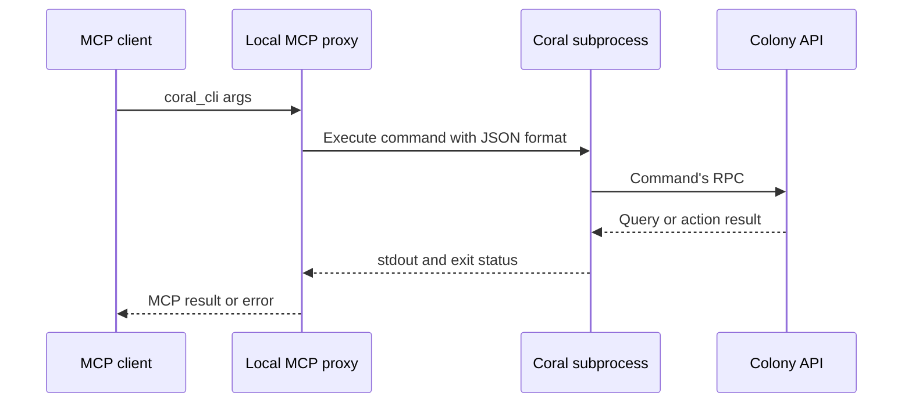

# MCP and LLM Integration

Coral's public MCP interface exposes one local tool, `coral_cli`. The tool takes
an array of command arguments, executes the Coral CLI as a subprocess, and
returns the output. The command then reaches the Colony or an agent through its
normal API path. Human operators and AI clients therefore use the same command
surface, with the same data freshness and handler behavior.

## External clients and local dispatch

`coral mcp proxy` speaks MCP JSON-RPC over stdio. It lists the `coral_cli` schema,
validates that a tool request contains an array of string arguments, and
executes the current Coral binary with those arguments. It supplies JSON output
formatting and writes the command trace to stderr, keeping stdout for MCP
responses.

For example, an MCP request with `args: ["query", "topology"]` launches
`coral query topology --format json`. That command calls the Colony's topology
API; its output becomes the tool result. The proxy does not open the Colony's
DuckDB directly and does not forward the request to a Colony-side MCP tool
registry.

The proxy captures stdout and stderr separately. A nonzero exit becomes an MCP
error with command and stderr context. Successful empty output gets a small
JSON success result. This translates command execution into the MCP contract;
it does not independently validate the application's diagnosis or make every
CLI command read-only.

Implementation: [proxy](../../internal/cli/colony/mcp.go).
User setup lives in [MCP](../MCP.md).

## The local reasoning loop

`coral ask` and the terminal interface use a provider-backed agent loop. In CLI
dispatch mode the agent registers `coral_cli`, includes a CLI reference generated
from the Cobra command tree, and executes requested commands locally. Results
are added to the conversation so the model can choose another operation or
produce an answer.

The current CLI system prompt attempts to fetch a compact topology through
`coral query topology` and instructs the model to call `coral services` to
discover available services. It does not require a successful topology fetch to
start a conversation. A failure or empty graph can omit that context. The
handler still contains helpers for older MCP-based service and summary calls;
their presence does not make them the CLI-mode initialization path.

The provider abstraction translates messages, tool definitions, and responses
for supported LLM backends. The operational data remains in the Colony and
agents, while the local conversation and provider requests carry the selected
context and command results. Conversation history is persisted locally for
multi-turn sessions. Choosing a provider is separate from choosing which Colony
the CLI queries.

Implementation: [agent loop](../../internal/cli/ask/agent.go),
[provider interface](../../internal/llm/provider.go), and
[LLM implementations](../../internal/llm/).

## Compatibility and architectural limits

The Colony's legacy `CallTool` responds that dispatch moved to the proxy,
`ListTools` returns an empty list, and `StreamTool` is unimplemented. They remain
in the server contract for compatibility; they are not the current public MCP
execution architecture.

Subprocess dispatch makes an operation reproducible as a command, but it does
not itself add role-based authorization or a durable audit store to every
handler. Access depends on the command's selected listener, credentials, and
server implementation. [Identity and trust](identity-and-trust.md) describes
those transport boundaries, and [remote execution](remote-execution.md)
describes command-session metadata at the agent.

Likewise, an LLM sees the same incomplete or delayed telemetry that the command
returns. [Service topology](service-topology.md) explains inferred edges;
[profiling](profiling.md) explains attribution limits. Scripts can combine
queries through [TypeScript investigations](typescript-investigations.md),
without changing the underlying evidence's scope.

Implementation: [legacy Colony tool handlers](../../internal/colony/server/server.go).

## Design history

- [RFD 030: Local Ask Agent](../../RFDs/030-coral-ask-local.md)
- [RFD 051: Interactive Terminal](../../RFDs/051-coral-ask-interactive-terminal.md)
- [RFD 054: Parameter Extraction](../../RFDs/054-coral-ask-smart-parameter-extraction.md)
- [RFD 055: Ask Configuration](../../RFDs/055-coral-ask-config.md)
- [RFD 100: CLI-Native Dispatch](../../RFDs/100-cli-native-agent-dispatch.md)
