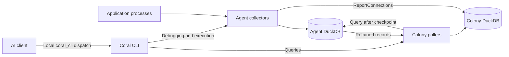

# System Overview

Coral separates observation of a running application from coordination of the
fleet. An agent runs near the processes it observes. A Colony maintains the
agent registry, pulls retained telemetry, and answers queries over the collected
data. The CLI provides the human interface and the execution surface for AI
clients. Mesh Discovery helps agents locate and enroll with a Colony; it is
outside the telemetry path.

This separation lets an agent keep collecting while its Colony is unreachable,
provided the collector is running and its local buffer has capacity. Recovery
is bounded by retention: a Colony cannot retrieve rows the agent has already
removed. [Data ownership](data-ownership.md) describes which data is retained
and which paths use memory or direct streaming instead.

## Components and responsibilities

| Component | Responsibility | State it owns |
| --- | --- | --- |
| Agent | Discover processes, collect telemetry, serve local queries and debugging actions | Service entries, collector state, recent telemetry and symbol caches |
| Colony | Enroll agents, track health, poll telemetry, derive summaries and topology | Registry, IP leases, CA state, checkpoints, collected data and derived views |
| CLI | Resolve targets, issue queries and actions, execute investigation scripts | Local configuration and conversation history |
| Mesh Discovery | Supply endpoint coordinates and referral tickets; carry opaque rendezvous records | External directory and rendezvous state |

The implementation boundaries are [agent](../../internal/agent/),
[Colony](../../internal/colony/), and [CLI](../../internal/cli/). RPC contracts
live in [proto](../../proto/); the generated Go types live in
[coral](../../coral/). Discovery's server implementation lives outside this
repository; the architecture here describes Coral's client contract.

## A telemetry operation

Consider an HTTP request observed by Beyla. The agent supervises Beyla as a
subprocess and receives its OTLP output through a dedicated loopback receiver.
It transforms a span and writes it to its local Beyla trace table. That table
assigns a sequence ID from its own sequence.

The Colony's Beyla poller asks for records after its checkpoint for that agent
and stream. The Colony stores the returned spans and advances the checkpoint
according to that poller's commit path. Later, a topology query can derive an
edge from relationships between spans in the Colony database. The query is
therefore subject to both polling lag and topology-cache freshness.

The main paths are shown below. The TCP observation path illustrates why
"pull based" does not describe every transfer in the system.

[Telemetry polling](telemetry-polling.md) explains the cursor and retry model;
[service topology](service-topology.md) explains what an inferred edge means.

## Reachability and authorization

WireGuard provides an encrypted network path between enrolled peers. Initial
bootstrap happens before that path exists, so it uses a separate TLS trust
protocol. The agent checks a configured Root CA fingerprint and Colony SPIFFE
identity; the Colony checks enrollment credentials before admitting the peer.
Discovery coordinates endpoints but does not replace these checks.

These boundaries matter independently. A reachable endpoint is not proof of
identity, and possessing a certificate does not imply every internal RPC is
served over mTLS. See [identity and trust](identity-and-trust.md) for the
implemented listener and credential boundaries, and
[discovery and enrollment](discovery-and-enrollment.md) for crash-resumable
registration.

## Queries and investigations

A query command calls a Colony API for fleet data or resolves an agent for a
local operation. External MCP clients invoke the local `coral_cli` tool, which
executes CLI commands as subprocesses. `coral ask` uses the same command surface
in its provider-backed reasoning loop. The Colony's old MCP tool-dispatch
endpoints are not the current execution path.

Scripts combine operations through the TypeScript SDK. Remote shell and
container execution run at the agent and have a separate session lifecycle from
telemetry polling. Their mechanisms are covered in
[MCP and LLM integration](mcp-and-llm.md),
[TypeScript investigations](typescript-investigations.md), and
[remote execution](remote-execution.md).

## Scheduling and failure isolation

`BasePoller` runs an initial poll and then periodic cycles, with a separate
cleanup loop. `ForEachHealthyAgent` visits up to 10 eligible agents concurrently
per cycle and continues after visitor errors or panics. Unhealthy agents are
skipped. Cancellation stops new visits and waits for in-flight callbacks, which
use the poll context for their queries. A slow agent occupies one worker until
its query finishes or times out; enough slow agents can still delay a cycle.

Implementation: [poller infrastructure](../../internal/colony/poller/base.go).

## Design history

- [RFD 001: Discovery Service](../../RFDs/001-discovery-service.md)
- [RFD 011: Multi-service Agents](../../RFDs/011-multi-service-agents.md)
- [RFD 044: Agent ID Standardization and Routing](../../RFDs/044-agent-id-standardization-and-routing.md)
- [RFD 089: Sequence-Based Polling](../../RFDs/089-sequence-based-polling-checkpoints.md)
- [RFD 100: CLI-Native Agent Dispatch](../../RFDs/100-cli-native-agent-dispatch.md)
